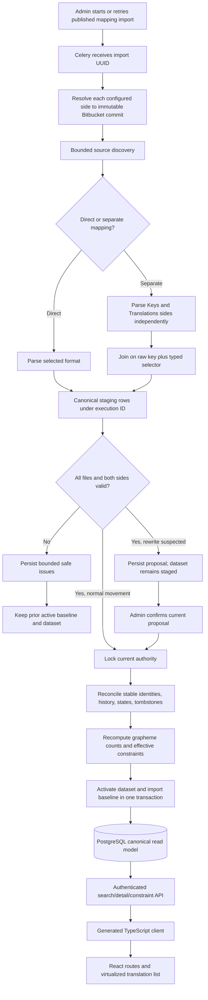

# Phase 4: Localization Import, Search, and Constraints - Research

**Researched:** 2026-09-04
**Domain:** Lossless localization parsing, atomic canonical refresh, indexed search, Unicode length constraints, and virtualized review navigation
**Confidence:** HIGH for repository architecture and locked product behavior; MEDIUM for external documentation and plan-resolved implementation contracts

<user_constraints>
## User Constraints (from CONTEXT.md)

### Locked Decisions

#### Format-specific structures and canonical presentation
- **D-01:** Import both scalar and structured localization values in v1: ordinary strings, Android and Qt plural/variant forms, Android arrays, and nested JSON string leaves. iOS support remains the configured `.strings` format; adding a separate `.stringsdict` format is not implied.
- **D-02:** Preserve every structured value as an individually addressable canonical value, while search results and detail presentation group those values by original key and language.
- **D-03:** Keep the repository key byte-for-byte as the logical key. Store plural quantity, array index, Qt variant, JSON path segment, or equivalent format detail as typed structured selectors rather than synthesizing dotted or bracketed key names. — **Reversibility:** costly — flattening selectors into keys later would change stable identities, search contracts, refresh matching, and eventual writer locators.
- **D-04:** Supported inline markup or other format structure must never be silently discarded. The parser must represent it without losing meaning or fail the mapping import atomically.
- **D-05:** A malformed, ambiguous, or unsupported file fails the complete mapping import. No partial dataset becomes visible; the last successful dataset remains active and the user receives a bounded list of actionable parser errors.
- **D-06:** A `separate` mapping remains one atomic boundary across its Keys and Translations sides, carrying forward the Phase 3 consistency rule.

#### Stable identity, deletion, and refresh behavior
- **D-07:** A logical key is identified within its repository and configured branch; file path and in-file position are mutable locators, not identity. A canonical translated value additionally uses its language and structured selector so sibling variants cannot collide. The mapping/repository-side ownership already established by prior phases must prevent cross-mapping collisions. — **Reversibility:** one-way — changing this after persisted imports would require an identity migration and could detach review state, comments, constraints, and write-back provenance.
- **D-08:** Moving the same key between files preserves identity. Renaming a key is never inferred: the old identity becomes deleted and the new key becomes a new identity.
- **D-09:** Deleted keys are soft-deleted. They are excluded from normal results but remain searchable through a dedicated deleted filter with their review state, comments, constraints, and source provenance intact.
- **D-10:** If Bitbucket changes the translated value for an existing identity outside a VerboFlex-tracked change, import accepts the new value, retains comments and constraints, preserves the previous state in history, and moves the current translation to `Draft`.
- **D-11:** If an imported value exactly matches a future VerboFlex-tracked change merged through its pull request, it is not an external modification: the pending change can become synchronized and the translation remains `Approved`. A divergent merged value follows D-10 and returns to `Draft`.
- **D-12:** If the source text for a logical key changes, every associated target-language translation returns to `Draft`; existing translated text, comments, and constraints remain available for re-review.
- **D-13:** Phase 4 must leave a durable correlation seam for later change-set and PR phases to prove whether an imported value is the exact result of a VerboFlex submission. It must not guess origin from equal text alone or execute any provider write.

#### Search and result loading
- **D-14:** The search page initially restores the user's last selected authorized product and provides an explicit `All products` option. A stale or unauthorized remembered selection must be discarded safely.
- **D-15:** Use one search field over original key, source text, and translated text. Matching is case-insensitive; exact matches rank before prefixes, prefixes before partial matches; fuzzy or typo-tolerant matching is excluded from v1.
- **D-16:** Initially restore the user's last selected available language and provide an explicit `All languages` option. Results remain grouped by key and language as defined by D-02.
- **D-17:** Use virtualized infinite scrolling backed by server-owned cursors and a deterministic stable order. Changing any search/filter dimension invalidates the loaded cursor chain; stale responses must not contaminate the new result set.
- **D-18:** The in-scope filters are product, language, approval state, maximum-length violation status, and deleted status. Normal results exclude deleted identities.

#### Maximum-character constraints
- **D-19:** A key may have a maximum-character limit for each language. The base language supplies a dynamically inherited default; a target-language override remains independent when the base value changes. — **Reversibility:** costly — inheritance semantics affect stored overrides, violation recomputation, API payloads, and future approval gates.
- **D-20:** Count user-perceived Unicode characters (extended grapheme clusters), not code points or encoded bytes. A composed character or combined emoji counts once. Non-visible format markup is not counted as display text.
- **D-21:** Admin and Product manager/reviewer roles may create, edit, and remove maximum-character constraints. Translator and Viewer roles may read limits and violation status but may not mutate them.
- **D-22:** A violating translation may be retained and saved as `Draft`, but it cannot become `Approved` or be submitted for write-back while the violation remains. Phase 4 calculates and exposes this authoritative state; later workflow phases enforce it at their mutation boundaries.
- **D-23:** Recalculate effective limits and violation state after import, after a base-language limit changes, after an override changes or is removed, and through the later translation-edit boundary.

### the agent's Discretion
- Choose the exact SQLAlchemy tables, parser adapter interfaces, typed selector schema, UUID strategy, indexes, cursor encoding, virtual-list library, overscan/page size, and deterministic search tie-breakers, provided all decisions above remain observable and testable.
- Choose whether the last product/language selection is stored as a non-sensitive browser preference or a server-side user preference; authorization and current availability must always be revalidated server-side.
- Store the selected base language on each mapping confirmation, copy it through candidate/publication cloning, and include it in confirmation currentness. Missing or ambiguous authority fails closed rather than choosing a locale. [RESOLVED FOR PHASE 4]
- Choose concise bounded parser and search error copy consistent with the existing generated-client and shadcn patterns.

### Deferred Ideas (OUT OF SCOPE)
- Add and delete localization keys from VerboFlex in a later phase; direct key rename remains excluded. Phase 4 only imports key additions/deletions observed in Bitbucket.
- Add a dedicated later phase for `max_bytes` constraints with an explicit encoding per mapping or file. This is separate from Phase 4's maximum-character contract.
- Editing translations, comments, state mutations, format-safe write-back, commits, and pull requests remain assigned to Phases 5–7.
</user_constraints>

<phase_requirements>
## Phase Requirements

The requirement text below is copied from `.planning/REQUIREMENTS.md`; the support column tells the planner where the implementation guidance lives.

| ID | Description | Research Support |
|----|-------------|------------------|
| FMT-01 | System can parse Android XML string resources into canonical translation records. | Android contract, lossless structure tree, adapter tests |
| FMT-02 | System can parse Qt `.ts` files into canonical translation records. | Qt identity/status/numerus/variant contract and fixtures |
| FMT-03 | System can parse JSON localization files into canonical translation records. | Duplicate-aware nested leaf traversal and strict value policy |
| FMT-04 | System can parse iOS `.strings` files into canonical translation records. | Existing lexer extension, encoding/escape fixtures, locators |
| FMT-06 | System validates parser behavior with golden fixtures for all supported v1 formats. | Cross-format golden corpus and conformance matrix |
| FMT-07 | System imports translations into a canonical model that includes product, repository, branch, file path, format, key, language, source text when available, translated text, state, and locator metadata. | Stable scope/key/value model and immutable import provenance |
| FMT-08 | System can refresh imported translations from Bitbucket without losing review states, comments, constraints, or audit history attached to stable translation identities. | Stage/reconcile/activate transaction and refresh truth table |
| SRCH-01 | Product manager can search and filter translations by product. | Authorized product option endpoint and indexed search query |
| SRCH-02 | Product manager can search for a specific translation in a selected language. | Language filter plus grouped key/language projection |
| SRCH-03 | Product manager can search by translation key or text. | Exact/prefix/partial relevance tiers and literal ILIKE patterns |
| SRCH-04 | Product manager can filter translations by approval state. | Value-state aggregation semantics and filter query |
| SRCH-05 | Product manager can filter translations by maximum-length constraint violation status. | Materialized effective constraint projection and index |
| SRCH-06 | User can open a translation detail view from search results. | Opaque stable group identifier and authenticated detail route |
| SRCH-07 | Translation detail view shows product, language, key, source text when available, translated text, state, file path, repository, branch, constraints, comments, and pending change status. | Complete read projection; Phase 4 placeholders for comments/pending change |
| SRCH-08 | Search results are paginated or virtualized so large translation sets remain usable. | Cursor-backed 50-group pages and TanStack window virtualization |
| CONS-01 | Authorized user can define a maximum character length constraint for a translation key. | Versioned base/default and target override model |
| CONS-02 | Authorized user can edit or remove a maximum character length constraint. | Role-gated PUT/DELETE and conflict protocol |
| CONS-03 | System calculates whether each translated value violates its configured maximum character length. | Server-side UAX #29 grapheme count and effective-limit projection |
| CONS-04 | System recalculates maximum-length violations after import and after translation edits. | Central recomputation service invoked by import now and edit seam later |
| CONS-05 | Translation detail view shows configured max length, actual length, and violation status. | Value-level actual/effective/source/status response fields |
</phase_requirements>

## Summary

Phase 4 should extend the existing Phase 3 import execution instead of building another job system. The production worker currently resolves all configured sides and records immutable file-reference metadata, while `finish_import_execution()` already locks product, revision, mapping, logical job, and execution before changing the active baseline. It does not yet parse or persist canonical translations: `_process_import()` returns only ordered source references. [VERIFIED: `backend/src/verboflex/services/import_jobs.py:1570-1745`, `backend/src/verboflex/services/import_jobs.py:2268-2302`] Add a bounded parser result to the worker result, stage it under the immutable execution ID, then reconcile and activate the canonical projection inside that existing finalization transaction. The same activation function must be called by rewrite confirmation, which currently changes only `active_baseline_execution_id`. [VERIFIED: `backend/src/verboflex/services/import_jobs.py:2060-2102`]

The canonical model must separate immutable identity from mutable location and text. Use a stable mapping scope derived from product plus the existing semantic `identity_key`, then a stable logical-key row and individually addressable value rows keyed by language plus a canonical typed-selector digest. The repository already serializes direct mapping authority as exactly `["direct", repository_id, source_branch]` and separate authority as exactly `["separate", keys_repository_id, keys_branch, translations_repository_id, translations_branch]`; mapping UUIDs are revision-owned, so they are not sufficient as the long-lived review identity. [VERIFIED: `backend/src/verboflex/services/mappings.py:142-164`; `backend/src/verboflex/models/product_mapping.py:25-80`] Preserve file paths, source spans, structure, and commit references as mutable/current locators plus immutable history.

Search should remain a PostgreSQL read model: literal case-insensitive matching over key/source/target, three explicit relevance tiers, grouped key/language rows, and deterministic keyset cursors. PostgreSQL's `pg_trgm` extension provides GiST/GIN operator classes for indexed `LIKE`/`ILIKE`, while `%` and `_` retain wildcard meaning and therefore require escaping when user text is intended literally. [CITED: https://www.postgresql.org/docs/current/pgtrgm.html] [CITED: https://www.postgresql.org/docs/current/functions-matching.html] The frontend should consume generated API types, use the UI-SPEC's exact 50-group pages and TanStack window virtualizer, and retain request-generation guards so stale responses never enter the active collection.

**Primary recommendation:** Plan the phase as parser contract → four adapters → golden checkpoint → staged atomic activation → indexed API projections → Unicode constraints → generated-client virtualized UI; never make a partially parsed execution visible.

## Architectural Responsibility Map

| Capability | Primary Tier | Secondary Tier | Rationale |
|------------|-------------|----------------|-----------|
| Bitbucket snapshot acquisition | API / Backend worker | External Bitbucket Cloud | Existing Celery worker owns slow provider reads and resolves configured branches to immutable commits. [VERIFIED: `backend/src/verboflex/worker/import_tasks.py:32-81`] |
| Four-format canonical parsing | API / Backend worker | — | Bytes are untrusted input; one server-side parser registry must produce deterministic canonical records before persistence. |
| Stable identity, history, tombstones | Database / Storage | API / Backend | PostgreSQL owns durable identity and review-context continuity; backend reconciliation applies locked rules. |
| Atomic dataset activation | API / Backend worker | Database / Storage | Backend validates execution authority; one transaction changes rows and baseline pointer together. |
| Search, filters, relevance, cursors | API / Backend | Database / Storage | Server owns authorization, matching semantics, deterministic order, and cursor integrity; PostgreSQL supplies indexes. |
| Detail projection | API / Backend | Browser / Client | API returns the complete authorized canonical group; the browser only presents it. |
| Grapheme counts and constraint status | API / Backend | Database / Storage | Server performs UAX #29 counting and persists/indexes authoritative projections; clients may only preview. |
| Virtualized result rendering | Browser / Client | API / Backend | Client limits mounted rows while the API limits loaded pages and owns cursor order. |
| Remembered product/language | Browser / Client | API / Backend | Store only non-sensitive principal-scoped IDs, then validate them against current server-authorized options. |

## Project Constraints (from AGENTS.md)

- Bitbucket Cloud is the only repository provider in v1.
- Frontend and backend remain separate applications.
- Frontend work uses React, Vite, TypeScript, and project-owned shadcn/ui component source.
- Backend work uses Python and FastAPI; PostgreSQL with SQLAlchemy and Alembic owns persistence and migrations.
- Repository imports and parsing run in Celery with Redis, never inside HTTP requests.
- Authentication is OAuth2 bearer-token based; authorization uses internal users with multiple roles and must be enforced by the backend.
- Every phase closes with targeted tests, code review, and build/deploy smoke verification.
- Supported localization formats are Android XML, Qt `.ts`, JSON, and iOS `.strings` only.
- Product, repository, branch, translation source, and later PR behavior remain configurable per project.
- Maximum character length is the only v1 validation constraint.
- Workflow states are Draft, approved, and rejected only; later editing/state-change functionality remains deferred.
- Figma integration is deferred.
- Existing project patterns take precedence where conventions/architecture documents are not yet populated.
- File changes must occur through a GSD workflow; this research is running under the Phase 4 planning workflow.

## Standard Stack

### Core

| Library / Service | Version | Purpose | Why Standard Here |
|-------------------|---------|---------|-------------------|
| Python | `>=3.14.7,<3.15` | Parser and backend runtime | This is the repository's exact runtime constraint: `">=3.14.7,<3.15"`. [VERIFIED: `backend/pyproject.toml:5-10`] |
| FastAPI | `0.141.1` | Authenticated search/detail/constraint APIs and OpenAPI | Exact current project pin: `"fastapi==0.141.1"`. [VERIFIED: `backend/pyproject.toml:10-25`] |
| SQLAlchemy / Alembic / psycopg | `2.0.52` / `1.19.1` / `3.3.4` | Canonical schema, PostgreSQL transactions, migrations | Exact current project pins: `"sqlalchemy==2.0.52"`, `"alembic==1.19.1"`, and `"psycopg[binary]==3.3.4"`. [VERIFIED: `backend/pyproject.toml:10-25`] |
| PostgreSQL + `pg_trgm` | `18-alpine` server | Durable canonical model and indexed literal substring search | Compose's database image is exactly `"postgres:18-alpine"`; `pg_trgm` is a supported PostgreSQL extension, not a third-party application package. [VERIFIED: `docker-compose.yml:34-48`] [CITED: https://www.postgresql.org/docs/current/pgtrgm.html] |
| Celery / Redis | `5.6.3` / Redis `7-alpine` | Bounded import parsing and job orchestration | Exact pins/images are `"celery[redis]==5.6.3"` and `"redis:7-alpine"`; existing worker passes a logical import UUID. [VERIFIED: `backend/pyproject.toml:10-25`; `docker-compose.yml:50-60`; `backend/src/verboflex/worker/import_tasks.py:92-111`] |
| `defusedxml` | `0.7.1` | Hardened XML boundary for Android and Qt | Exact existing pin: `"defusedxml==0.7.1"`; preview parsers already reject DTD/entities/external references. [VERIFIED: `backend/pyproject.toml:10-26`] |
| React / TypeScript / Vite | `19.2.8` / `6.0.3` / `8.2.2` | Search/detail/constraint SPA | Exact existing pins: `"react": "19.2.8"`, `"typescript": "6.0.3"`, `"vite": "8.2.2"`. [VERIFIED: `frontend/package.json:20-33`, `frontend/package.json:35-62`] |
| shadcn/ui | CLI `4.19.0` plus owned components | UI primitives and established visual system | Exact dev pin is `"shadcn": "4.19.0"`; UI-SPEC forbids a replacement data grid or third-party visual block. [VERIFIED: `frontend/package.json:35-62`; `.planning/phases/04-localization-import-search-and-constraints/04-UI-SPEC.md:232-248`] |

### Supporting

| Library | Version | Purpose | When to Use |
|---------|---------|---------|-------------|
| `regex` [WARNING: flagged as suspicious — verify before using.] | `2026.9.3` | UAX #29 `\X` grapheme-cluster segmentation | Use only in the backend's central display-text counter; official package metadata says Python `>=3.10` and documents `\X` as one grapheme. [CITED: https://pypi.org/project/regex/] |
| `@tanstack/react-virtual` [WARNING: flagged as suspicious — verify before using.] | `3.14.10` | Window virtualization with dynamic measurement | UI-SPEC locks the v3 React adapter, `useWindowVirtualizer`, measured rows, 288px estimate, overscan 8, and `useFlushSync: false`. [CITED: https://tanstack.com/virtual/latest/docs/framework/react/react-virtual] [VERIFIED: `.planning/phases/04-localization-import-search-and-constraints/04-UI-SPEC.md:118-150`] |
| Python stdlib `json` | Runtime | Duplicate-aware nested JSON parser | Supply `object_pairs_hook`; reject duplicates before recursive leaf extraction. RFC 8259 says member names should be unique because duplicate handling is unpredictable. [CITED: https://www.rfc-editor.org/rfc/rfc8259] |
| Existing generated OpenAPI client | Repository-owned | Typed browser contracts | Regenerate from FastAPI; do not hand-write a parallel translation client. Exact scripts are `"api:generate"` and `"api:check"`. [VERIFIED: `frontend/package.json:6-18`] |

### Alternatives Considered

| Instead of | Could Use | Tradeoff |
|------------|-----------|----------|
| Existing per-format parser modules plus shared canonical contract | One generic XML/JSON normalizer | Reject: it cannot preserve format-specific identity, inline structure, escapes, or write-back locators. |
| `regex` `\X` | Custom Unicode range logic or `len()` | Reject: code-point length is not extended-grapheme length and Unicode segmentation changes over time. [CITED: https://www.unicode.org/reports/tr29/] |
| PostgreSQL `pg_trgm` plus B-tree relevance paths | External search service | Reject for v1: exact/prefix/partial matching and current scale do not justify another consistency boundary. |
| TanStack Virtual v3 | Custom virtual-scroll math | Reject: dynamic row measurement, overscan, keys, and scroll correction are deceptively complex. |
| Principal-scoped local preference | New server preference table | Use local storage for only product/language IDs; server-side storage adds schema/API work without improving authority because values still require revalidation. |

**Installation (after the two required human-verification checkpoints):**

```bash
uv add --project backend "regex==2026.9.3"
npm --prefix frontend install --save-exact @tanstack/react-virtual@3.14.10
```

No parser framework, search service, state-management library, or packaged data grid should be added.

## Package Legitimacy Audit

| Package | Registry | Age | Downloads | Source Repo | Verdict | Disposition |
|---------|----------|-----|-----------|-------------|---------|-------------|
| `regex` | PyPI | Published since 2011; selected release published 2026-09-01 [CITED: https://pypi.org/project/regex/] | Registry seam did not return download data | `github.com/mrabarnett/mrab-regex` | SUS: latest release too new; downloads unknown | Flagged — planner must add `checkpoint:human-verify` before install |
| `@tanstack/react-virtual` | npm | Created 2022-02-07; selected release published 2026-08-18 [CITED: https://www.npmjs.com/package/@tanstack/react-virtual] | 23,240,523/week at research time | `github.com/TanStack/virtual` | SUS: latest release too new | Flagged — planner must add `checkpoint:human-verify` before install |

Registry verification returned PyPI latest `regex` `2026.9.3` with `Requires-Python >=3.10` and npm latest `@tanstack/react-virtual` `3.14.10`; the npm package exposes no `postinstall` script. [CITED: https://pypi.org/project/regex/] [CITED: https://www.npmjs.com/package/@tanstack/react-virtual] Both package names were confirmed by their official project documentation, but neither earns `[VERIFIED: registry]` because the mandatory legitimacy seam returned `SUS`, not `OK`.

**Packages removed due to [SLOP] verdict:** none

**Packages flagged as suspicious [SUS]:** `regex`, `@tanstack/react-virtual`; the planner must insert a human verification checkpoint before each install.

## Architecture Patterns

### System Architecture Diagram



### Recommended Project Structure

The exact filenames are discretionary; preserve the existing package boundaries and keep pure parsing separate from database reconciliation.

```text
backend/src/verboflex/
├── localization/importing/
│   ├── core.py                 # canonical parser records, selectors, issues, bounds
│   ├── registry.py             # exact format adapter dispatch
│   ├── android_xml.py
│   ├── qt_ts.py
│   ├── json.py
│   └── ios_strings.py
├── models/
│   ├── translation.py          # stable scope, key, value, history, locator
│   └── translation_constraint.py
├── services/
│   ├── translation_imports.py  # stage, reconcile, activate, rewrite activation
│   ├── translation_search.py
│   └── translation_constraints.py
├── schemas/translations.py
└── api/v1/routes/translations.py

backend/tests/
├── fixtures/localization/      # file bytes plus explicit expected canonical JSON
├── unit/localization/importing/
├── integration/test_translation_import_activation.py
├── integration/test_translation_search.py
└── api/test_translations.py

frontend/src/features/translations/
├── TranslationSearchPage.tsx
├── TranslationDetailPage.tsx
├── TranslationFilters.tsx
├── TranslationResultList.tsx
├── MaximumLengthDialog.tsx
├── useTranslationSearch.ts
└── translationPreferences.ts
```

### Pattern 1: Pure, Bounded Parser Adapter

**What:** Each adapter accepts repository-side/path/bytes plus the confirmed layout/base-language authority and returns immutable canonical entries or closed parser issues. Parsing has no SQLAlchemy, FastAPI, Celery, or Bitbucket dependency.

**When to use:** Every file in a validated import snapshot.

The existing preview registry already dispatches exactly four formats—`"android_xml"`, `"qt_ts"`, `"json"`, and `"ios_strings"`—and drops overlapping interpretations. [VERIFIED: `backend/src/verboflex/localization/preview/core.py:12-19`; `backend/src/verboflex/localization/preview/registry.py:20-46`] Canonical parsing should reuse safe decoding/detection primitives, not preview samples, because preview contracts explicitly describe samples as partial rather than canonical. [VERIFIED: `backend/src/verboflex/localization/preview/core.py:45-100`]

Recommended result shape:

- `logical_key`: the repository key exactly as decoded; never case-fold or synthesize path notation.
- `language`: existing bounded locale normalization where the configured format supplies a locale.
- `selector`: versioned, typed, canonical JSON; its digest participates in value identity.
- `display_text`: visible text only, used for search and grapheme counts.
- `structure`: ordered lossless semantic nodes/attributes needed to represent supported markup and variants.
- `locator`: format, repository side, latest path, source spans or structural address, and immutable commit/source-reference linkage.
- `source_text` and `translated_text`: remain separate and nullable where a topology cannot supply source text.
- Issues: closed category, repository side, path, safe line/column when available; no raw fragments or exception text.

Selector discriminators are exactly `"scalar"`, `"android_quantity"`, `"android_array_item"`, `"qt_numerus"`, `"qt_length_variant"`, and `"json_path"`. [RESOLVED FOR PHASE 4] Plan 04-01 locks them in one schema/version test before any adapter is implemented; adapters may not invent additional discriminator JSON.

### Pattern 2: Stable Scope → Key → Value Identity

**What:** Introduce a stable localization scope keyed by `(product_id, mapping.identity_key)`, then key identity by scope/repository/branch/raw logical key, and value identity by key/language/canonical selector. Use stored UUIDs as opaque API IDs; enforce natural-key uniqueness in PostgreSQL.

**When to use:** Import reconciliation, search grouping, detail routing, constraint ownership, history, and later comments/pending changes.

Recommended relational responsibilities:

| Entity | Stable columns | Mutable/current columns |
|--------|----------------|-------------------------|
| Localization scope | product, semantic mapping identity/topology | active mapping/execution references |
| Translation key | scope, key repository, configured branch, raw logical key | deleted flag/time, last import, source summary |
| Translation value | key, normalized language, selector version/digest | text, internal review state, grapheme count, effective max, violation, deleted state |
| Value locator | value plus current import | repository side/path/format/structure/source span/commit |
| Value history | value, import execution, previous revision | prior text/state/count/provenance and future change-correlation evidence |
| Staged import entry | execution, manifest position, canonical identity payload | none; immutable until activation or cleanup |
| Parse issue | execution, deterministic issue order | closed category, repository side, path, safe coordinates, bounded aggregate count |
| Constraint | key, exact language | max characters, version, actor/timestamps |

The current mapping row is revision-owned and its exact topology values are `"direct"` and `"separate"`; its semantic `identity_key` is unique within a revision. [VERIFIED: `backend/src/verboflex/models/product_mapping.py:25-80`] A stable scope avoids detaching review state when a published mapping is cloned into a new configuration revision with a new mapping UUID but the same repository/branch identity.

For Qt, use `<message id>` as the raw key when present. When it is absent, use the original `<source>` text as the raw key and keep context/disambiguation in selectors; therefore a changed id-less Qt source is observably a delete-plus-add under D-08, while D-12 applies where source text is separate from a stable logical key. Qt documents both context/source messages and optional IDs; ID-based messages require unique IDs. [CITED: https://doc.qt.io/qt-6/linguist-ts-file-format.html] [CITED: https://doc.qt.io/qt-6/linguist-id-based-i18n.html]

For nested JSON, use the leaf member name byte-for-byte as `logical_key` and preserve ordered parent path segments as the typed selector; a flat key containing `.` remains one unsplit raw key. [RESOLVED FOR PHASE 4] This keeps sibling leaves independently addressable without manufacturing a dotted identity.

### Pattern 3: Stage, Reconcile, Then Atomically Activate

**What:** Provider I/O and parsing happen outside the final transaction. Persist immutable execution-scoped staging data, then lock and revalidate the existing import authority and reconcile the complete mapping into stable rows in one bounded transaction. Update active dataset authority and `active_baseline_execution_id` together.

**When to use:** Normal imports and confirmed rewrite proposals.

SQLAlchemy documents that a `Session.begin()` context commits on success and rolls back on exceptions. [CITED: https://docs.sqlalchemy.org/en/20/orm/session_transaction.html] The current finalizer already uses `factory.begin()`, row locks, exact execution/currentness checks, and sets the baseline only after reference validation. [VERIFIED: `backend/src/verboflex/services/import_jobs.py:1570-1745`] Extend this exact seam rather than nesting a second commit inside it.

Required activation order:

1. Verify all expected mapping sides are present and every source reference matches the staged parse manifest.
2. Reject all parser issues; persist only bounded safe diagnostics, not partially canonical data.
3. Lock stable scope and current import authority.
4. Upsert identities by natural keys; append history before changing current text/state.
5. Apply D-10/D-12 state transitions, source/value changes, and tombstones; never correlate a rename.
6. Recompute all affected value counts/effective limits/violations.
7. Point the scope and import job at the same activated execution, then commit.

If source movement produces a rewrite proposal, keep staging immutable but inactive. `confirm_rewrite_baseline()` currently changes only the baseline pointer and proposal status; it must call the same activation service before commit or the file baseline and visible translations can disagree. [VERIFIED: `backend/src/verboflex/services/import_jobs.py:2060-2102`]

Refresh transition truth table:

| Incoming condition | Identity action | Text/history action | Current state |
|--------------------|-----------------|---------------------|---------------|
| Same key/value/selector | Reuse | Update mutable locator/path only | Preserve |
| Same identity, external translated text changed | Reuse | Append previous revision, replace current text | Draft |
| Same stable key, source text changed | Reuse key/targets | Append source revision; preserve target text/context | Every target Draft |
| File path/position changed only | Reuse | Update locator | Preserve |
| Raw key changed | Old tombstoned; new identity | No inferred relationship | Old state preserved on tombstone; new Draft |
| Identity absent from successful complete import | Tombstone | Keep last-known content/provenance/context | Preserve |
| Exact future VerboFlex correlation proven | Reuse | Record synchronization evidence | Approved remains |
| Equal text without correlation evidence | Reuse | Treat origin as unproven | Never infer Approved |
| Any malformed/ambiguous/unsupported input | No active-row mutation | Store bounded failure only | Prior dataset remains active |

Initial storage values for the internal review state are exactly `"draft"`, `"approved"`, and `"rejected"`. [RESOLVED FOR PHASE 4] Plan 04-01 freezes the shared vocabulary before migration code and Plan 04-10 enforces it in PostgreSQL.

The future PR-correlation seam does not need a guessed “synchronized” flag in Phase 4. A stable value UUID, immutable value-revision digest, and exact import execution/commit provenance give later pending-change records durable values to reference; only later verified submission evidence may select the D-11 branch.

### Pattern 4: Deterministic Grouped Search With Cursor Binding

**What:** Build candidate matches across key, source, and translated text, assign rank `0` exact / `1` prefix / `2` partial / `3` no-query, reduce to one key-language group, and order by `(rank, stable_casefolded_key, language, group_uuid)`. [RESOLVED FOR PHASE 4] The cursor carries a version, a digest of the normalized query/filters/authorized scope, and the last complete order tuple.

**When to use:** Every translation collection request, including empty search.

Use bound SQLAlchemy parameters throughout. Escape `\`, `%`, and `_` in literal user input and declare the same escape character in `ILIKE`; otherwise a search for an actual underscore or percent sign changes semantics. PostgreSQL documents both wildcard behavior and indexed trigram support for `LIKE`/`ILIKE`. [CITED: https://www.postgresql.org/docs/current/functions-matching.html] [CITED: https://www.postgresql.org/docs/current/pgtrgm.html]

Indexes should cover:

- B-tree case-folded raw key/language/group ID paths for exact/prefix/default ordering.
- GIN `gin_trgm_ops` on the normalized searchable key, source-display text, and translated-display text for partial matching.
- Product/scope, language, state, deleted, and violation filter columns.
- The natural uniqueness constraints used by import reconciliation.

Search returns 50 groups plus one lookahead row and emits a cursor only when another group exists. The server validates cursor version, filter digest, authorized scope, tuple types/lengths, and exact canonical decoding; malformed/stale/mismatched cursors return bounded client errors. The UI-SPEC fixes 50 groups per page, an explicit Load more fallback, request-generation invalidation, and repeated/empty cursor guards. [VERIFIED: `.planning/phases/04-localization-import-search-and-constraints/04-UI-SPEC.md:118-150`]

Group-state filtering is resolved as follows: a grouped row matches a requested review state when any canonical value in that group has that state, while detail returns all individual value states and labels mixed groups. [RESOLVED FOR PHASE 4] Plans 04-13 and 04-15 freeze this in API/OpenAPI tests.

### Pattern 5: Materialized Constraint Projection With Central Recalculation

**What:** Store one explicit row per key/language. A target row is an override; absent target row inherits the base-language row dynamically. Store `grapheme_count`, resolved `effective_max_chars`, effective source, and `is_over_limit` on each current value for fast filters; a single service recomputes every affected value transactionally.

**When to use:** Canonical activation, constraint PUT/DELETE, future translation edit, and future approval/submission gates.

Unicode UAX #29 defines extended grapheme clusters as the default boundary for user-perceived characters; Python's maintained `regex` package exposes `\X` for one grapheme. [CITED: https://www.unicode.org/reports/tr29/] [CITED: https://pypi.org/project/regex/] Count the parser's visible `display_text`, never raw XML/Qt markup or serialized JSON escape syntax.

Store base language on the mapping confirmation and copy it during candidate/active revision cloning. Add it to preview confirmation currentness so changing the chosen base invalidates stale confirmation. The current confirmation signature accepts only job/digest/layout candidate/version/actor and persists only selected layout/confirmation fields; it has no base-language authority today. [VERIFIED: `backend/src/verboflex/services/preview_jobs.py:825-898`; `backend/src/verboflex/models/product_mapping.py:81-110`]

Use an integer `version` on each constraint. PUT/DELETE require `expected_version`; lock the row/key and return a conflict projection when it changed. Do not optimistically mutate browser authority. Exact mutation roles already exist as the verbatim role names `"admin"` and `"product_manager_reviewer"`; read-only roles are `"translator"` and `"viewer"`. [VERIFIED: `backend/src/verboflex/models/role.py:18-23`] Reuse `require_roles()` for mutations and `CurrentPrincipal` for reads. [VERIFIED: `backend/src/verboflex/auth/principal.py:106-144`]

Allow maximum values from `0` through `1_048_576` inclusive. [RESOLVED FOR PHASE 4] Zero expresses “must be empty”; Plan 04-10 freezes the database bound and Plans 04-21/04-15 freeze the API/generated-client bound.

### Pattern 6: Complete Server Projection, Thin Generated Client

**What:** FastAPI returns complete bounded search/detail/constraint projections, including server-calculated counts and effective-source labels. Regenerate the TypeScript client and keep collection state in a feature hook/reducer patterned after existing generation guards.

**When to use:** All Phase 4 browser work.

Add ordinary authenticated routes for `/translations` and `/translations/:translationGroupId`; the current session router exposes only `/` and `/admin/*`, and the shell's only ordinary destination is exactly `{ label: "Workspace", to: "/" }`. [VERIFIED: `frontend/src/router.tsx:90-149`; `frontend/src/components/layout/AppShell.tsx:42-64`] Add `Translations` after Workspace for all authenticated principals; do not weaken the separate admin guard.

Store remembered product/language IDs under a principal-scoped local key. Do not store search text, source/translated text, logical keys, paths, commits, or API responses. Resolve authorized options first and discard stored IDs that are absent. The feature route owns list query snapshot, scroll offset, and focus restoration in React memory only.

TanStack's React adapter provides `useWindowVirtualizer`; the Virtualizer API provides dynamic `measureElement`, overscan, stable `getItemKey`, and `useFlushSync`. [CITED: https://tanstack.com/virtual/latest/docs/framework/react/react-virtual] [CITED: https://tanstack.com/virtual/latest/docs/api/virtualizer] Use the locked `288px` estimate, overscan `8`, actual row measurement, and `useFlushSync: false`; render list/listitem semantics and never let all loaded rows accumulate in the DOM.

### Anti-Patterns to Avoid

- **Activating baseline before translations:** produces source authority that does not match visible content; one transaction owns both.
- **Using mapping UUID as permanent review identity:** configuration publication may clone a semantic mapping under a new revision-owned UUID.
- **Including file path or ordinal in identity:** ordinary moves would detach review state and constraints.
- **Flattening selectors into dotted/bracketed keys:** permanently corrupts raw key identity and makes later writer mapping ambiguous.
- **Treating preview samples as an import:** preview is deliberately bounded/partial and does not model all supported structures.
- **One giant parser transaction:** holding database locks during XML/JSON parsing or provider calls harms concurrency and failure recovery.
- **Python `len(text)` or browser string length:** both count units other than extended grapheme clusters.
- **Raw `ILIKE('%' + query + '%')`:** wildcard characters alter literal search and an unbounded leading wildcard may miss efficient plans without trigram indexes.
- **Offset pagination:** concurrent refresh/tombstone changes produce skips/duplicates and cannot bind request generation.
- **Client-derived authorization/state/violation:** API calls bypass hidden controls; server projections remain authoritative.
- **Rendering imported markup as HTML:** all imported content is untrusted; expose safe structure metadata or literal text only.
- **Catching per-file parser errors and continuing:** violates the mapping-level atomic boundary, especially for separate mappings.

## Canonical Parser Contracts

### Cross-Format Contract

All adapters must be deterministic for identical `(format, repository side, path, bytes, confirmed layout version, base language)` input. They must enforce discovery ceilings already set to exactly `50` pages, `5_000` entries, depth `12`, `500` candidate files, `1_048_576` bytes per file, and `20_971_520` bytes total. [VERIFIED: `backend/src/verboflex/services/repository_discovery.py:110-128`] Add parser-specific nesting/value/issue ceilings inside those provider bounds.

The public issue taxonomy is closed by the UI contract to `"Malformed file"`, `"Ambiguous structure"`, `"Unsupported structure"`, `"Duplicate key"`, and `"Base language required"`; show at most five issues and one remaining count. [VERIFIED: `.planning/phases/04-localization-import-search-and-constraints/04-UI-SPEC.md:309-317`] Internally preserve a stable code and safe coordinates, but never persist or expose raw exception strings/source excerpts/provider bodies.

### Android XML

Android officially defines string, string-array, and plurals resources, with resource `name` identifiers and platform escaping/styling semantics. [CITED: https://developer.android.com/guide/topics/resources/string-resource] Implement:

- Require a hardened `<resources>` document and continue forbidding DTDs, entities, and external references.
- Accept direct `<string name>`, `<plurals name>/<item quantity>`, and `<string-array name>/<item>` structures only; reject duplicate names and duplicate quantities.
- The exact Android attribute allowlist is: `<string>` requires `name` and permits only optional `translatable="true|false"` and `formatted="true|false"`; `<plurals>` and `<string-array>` require `name` and permit only optional `translatable="true|false"`; plural `<item>` requires only one Android-defined `quantity` value (`zero|one|two|few|many|other`); array `<item>` permits no attributes. Duplicate attributes, namespace substitutions, and every other resource/item attribute are unsupported.
- Keep array index and plural quantity as typed selectors; order is semantic for arrays.
- Parse mixed text/inline elements/tails into an ordered semantic structure plus visible display text. The exact inline allowlist is unnamespaced `<b>`, `<i>`, and `<u>` with no attributes, plus `{urn:oasis:names:tc:xliff:document:1.2}g` with required nonempty `id` and optional `example` only. Nested allowlisted nodes, their text/tails, XML comments, and CDATA lexical spans are preserved in ordered structure/locator metadata; CDATA contributes its content, not its wrapper, to display text. Unknown inline elements, attributes, namespaces, processing instructions, or other node kinds fail the complete mapping.
- Preserve Android escape meaning and raw locator spans/structural addresses separately; do not count tags as visible characters.
- Derive locale from the confirmed layout/path using the existing locale normalization; do not broaden Phase 2 locale grammar incidentally.

Golden cases must include scalar/empty/escaped text, apostrophe/quote/backslash, `%` formatting, CDATA, styled inline markup and tails, XLIFF placeholders, plural quantities, array ordering, duplicate resources, malformed XML, DTD/entity attempts, unknown elements/attributes/namespaces/node kinds, invalid encoding, and exact boundary sizes. Plans 04-01, 04-02, and 04-06 lock the allowlist above before the parser checkpoint; the checkpoint does not choose semantics.

### Qt `.ts`

Qt's TS format defines TS-level source/target language, contexts, optional message IDs, source/comment disambiguation, numerus forms, length variants, locations, and translation lifecycle/status metadata. [CITED: https://doc.qt.io/qt-6/linguist-ts-file-format.html] Implement:

- Require root `<TS>` version exactly `2.0` or `2.1`, required normalized `language`, optional normalized `sourcelanguage`, and no other root attributes. Root children are limited to at most one text-only attribute-free `defaultcodec`, at most one attribute-free `dependencies`, and ordered `context` elements; metadata is preserved but never enters stable identity. `dependencies` contains only one-or-more empty `dependency` children, each permitting only optional nonempty `catalog`.
- Use message ID when present; otherwise source text is the raw key. Preserve context, disambiguation comment, numerus quantity/form position, and length-variant priority as typed metadata/selectors.
- A `context` has no attributes and contains exactly one text-only `name`, zero-or-more text-only `comment`, then ordered `message` elements. Message attributes are limited to optional nonempty `id` and optional `numerus="yes|no"`; message children are limited to ordered empty `location`, required text-only `source`, optional text-only `oldsource`, optional text-only `comment`, optional text-only `oldcomment`, optional text-only `extracomment`, optional text-only `translatorcomment`, optional text-only `userdata`, and exactly one `translation`. Multiple `<location>` nodes are preserved as locators, not identity; each permits only optional nonempty `filename` and optional `line`, with omitted filename reusing the previous resolved filename and `line` retained as its validated absolute/relative integer token.
- Preserve translation type/status metadata but never map it directly to VerboFlex approval. Initial/current internal review state follows the import reconciliation rules.
- Translation attributes are limited to optional `type="unfinished|obsolete|vanished"` and optional `variants="yes"`. Plain translation text, one-or-more `<numerusform>` children, and one-or-more `<lengthvariant priority="N">` children are mutually exclusive shapes. A numerus message requires `numerus="yes"` and one-or-more `numerusform`; a non-numerus message rejects them. A plain `numerusform` has no attributes and text only; a nested-variant `numerusform` permits exactly `variants="yes"` and contains only one-or-more `lengthvariant`. Each `lengthvariant` permits exactly one unique positive-integer `priority` and text only. Top-level length variants require translation `variants="yes"`; nested numerus variants use `qt_length_variant` with both numerus index and priority fields. `unfinished` or absent type imports as current Draft; `obsolete` and `vanished` import as deleted/tombstoned. [RESOLVED FOR PHASE 4]
- Text-bearing Qt fields accept text plus escaped markup as literal content. Actual child markup, `<byte>` nodes, processing instructions, unknown children/attributes, mixed direct text with variant children, duplicate canonical identities, unknown status/variant combinations, ambiguous language, or malformed XML are unsupported and fail the complete mapping; no construct is flattened or discarded.

Golden cases must include ID-based and source-based messages, same source in distinct contexts/comments, numerus forms, length variants/priorities, unfinished/obsolete/vanished, empty translation, old/new locations, markup/byte nodes, duplicates, malformed/DTD input, and locale normalization.

### JSON

RFC 8259 says object names should be unique because duplicate handling varies, requires UTF-8 for open ecosystem interchange, and documents interoperability risk for unpaired surrogate sequences. [CITED: https://www.rfc-editor.org/rfc/rfc8259] Implement:

- Decode UTF-8 strictly; reject BOM, unpaired surrogates, duplicate members at every nesting level, NUL/control violations, excessive nesting, and trailing data.
- Accept the already confirmed flat-per-locale or locale-rooted layout, then recursively walk object members in source order.
- Import only string leaves; reject arrays, numbers, booleans, null, and ambiguous mixed locale/content structures rather than stringifying.
- Keep a leaf's member name raw; preserve parent member segments as ordered typed selector data; never split a flat member containing dots/brackets.
- An empty object is a valid zero-entry file, but the complete mapping must still resolve the configured base language. [RESOLVED FOR PHASE 4]

Golden cases must include flat/nested/locale-rooted content, repeated leaf names under different parents, escaped keys/text, Unicode and surrogate pairs, empty strings/objects, duplicates at all levels, non-string leaves/arrays, BOM, invalid UTF-8, unpaired surrogates, deep nesting, and maximum size/count boundaries.

### iOS `.strings`

Apple documents `.strings` as comments and quoted key/value assignments terminated by semicolons, and documents UTF-8/UTF-16 input handling. [CITED: https://developer.apple.com/library/archive/documentation/Cocoa/Conceptual/LoadingResources/Strings/Strings.html] [CITED: https://developer.apple.com/library/archive/documentation/Cocoa/Conceptual/Strings/Articles/readingFiles.html] Extend the existing bounded lexer rather than replace it:

- Retain strict UTF-8 and BOM-qualified UTF-16 decoding; never heuristic-decode arbitrary bytes.
- Preserve comments, key/value source spans, quote/escape style, and file order as locator/structure metadata while decoded key remains identity.
- Reject duplicate decoded keys, malformed escapes/Unicode sequences, missing separators/semicolon, NUL/control errors, and trailing junk.
- Keep scalar selector only; `.stringsdict` is out of scope.

Golden cases must include UTF-8 with/without BOM, UTF-16 LE/BE BOM, comments, whitespace, empty values, quote/backslash/newline/tab and Unicode escapes, surrogate pairs, duplicate decoded keys, malformed/comment/string termination, invalid BOM/encoding, and boundary sizes.

### Separate Mapping Join

Parse both sides completely before joining. Join by normalized language authority plus raw logical key and canonical selector; reject duplicate or structurally incompatible join candidates atomically. Translation-side entries without a matching key-side source remain canonical with `source_text = null` because the requirement says source text “when available”; key-side entries without a target value do not manufacture an empty translation. [RESOLVED FOR PHASE 4] Plan 04-06 freezes these semantics in cross-side golden fixtures before import activation.

## Don't Hand-Roll

| Problem | Don't Build | Use Instead | Why |
|---------|-------------|-------------|-----|
| XML entity security | String scans for `DOCTYPE` or custom entity expansion | Existing `defusedxml` boundary | Entity/DTD/external reference attack variants are subtle. [CITED: https://cheatsheetseries.owasp.org/cheatsheets/XML_External_Entity_Prevention_Cheat_Sheet.html] |
| Grapheme segmentation | Unicode-range tables or `len()` | `regex` `\X` after checkpoint | UAX #29 rules cover combining marks, emoji sequences, regional indicators, and evolve with Unicode. |
| Virtual list math | Scroll offsets, measurement cache, overscan logic | TanStack Virtual v3 after checkpoint | Dynamic multi-line rows and scroll correction are library-level concerns. |
| API client | Hand-authored TypeScript fetch types | Existing FastAPI OpenAPI + generated client | Prevents drift in bounds, enums, errors, and auth options. |
| Import queue/retry | New thread/process/job table | Existing Celery/import job/execution/watchdog | Phase 3 already owns durable currentness, retry, and stale-worker recovery. |
| Search service | Elasticsearch/OpenSearch | PostgreSQL B-tree + `pg_trgm` | v1 matching is exact/prefix/partial, not fuzzy or analytics-heavy. |
| Rename inference | Text similarity/path heuristics | Explicit tombstone plus new identity | Heuristics detach review context and violate D-08. |
| HTML sanitizer as renderer | Executing imported markup after sanitization | Text blocks plus typed structure metadata | Format markup is data, not web UI markup. |

**Key insight:** The hard part is authority and preservation, not syntax recognition. Standard Unicode/XML/virtualization/query primitives should contain their edge cases while VerboFlex owns only format semantics, stable identity, and atomic lifecycle rules.

## Common Pitfalls

### Pitfall 1: Import baseline and canonical dataset diverge

**What goes wrong:** The job is marked current but search still exposes old/partial rows, or canonical rows activate while the old source baseline remains authoritative.

**Why it happens:** Parsing/staging/activation are added as separate transactions around the existing finalizer, or rewrite confirmation moves only the baseline pointer.

**How to avoid:** One activation function runs under the exact finalizer/confirmation locks and changes stable rows, active execution, and baseline together.

**Warning signs:** Search rows reference a commit different from `require_current_import_baseline()`, an execution has active rows before it is succeeded, or rewrite confirmation tests assert only the import-job pointer.

### Pitfall 2: “Stable” IDs contain mutable locators

**What goes wrong:** File moves create new result/detail IDs and detach constraints/history.

**Why it happens:** Paths, XML ordinals, JSON offsets, or transient mapping UUIDs are convenient unique keys.

**How to avoid:** Natural identity contains semantic mapping authority, configured repository/branch, raw key, language, and selector only; path/position remain locator revisions.

**Warning signs:** Moving an unchanged fixture produces a tombstone/new pair, a detail URL 404s after refresh, or constraints disappear after configuration cloning.

### Pitfall 3: Structured forms collide or become synthetic keys

**What goes wrong:** `one` and `other`, two array items, Qt variants, or repeated nested JSON leaf names overwrite each other.

**Why it happens:** Adapters flatten variants into strings inconsistently or ignore typed selector canonicalization.

**How to avoid:** Freeze one versioned selector schema and canonical serializer before format adapters; enforce `(key, language, selector_digest)` uniqueness and retain structured fields separately.

**Warning signs:** API keys contain brackets/dots invented by VerboFlex, selector ordering changes digests, or fixture round-trips lose sibling values.

### Pitfall 4: Markup loss corrupts text and counts

**What goes wrong:** Inline tags/placeholders vanish, literal tags appear in counts, or future writers cannot recreate the source meaning.

**Why it happens:** `itertext()` or equivalent is treated as the complete canonical representation.

**How to avoid:** Produce both a visible display-text projection and an ordered lossless structure representation; fail unsupported structures.

**Warning signs:** A styled fixture and its plain-text equivalent have identical canonical structure, attributes/tails disappear, or grapheme count includes markup syntax.

### Pitfall 5: Unicode count drift

**What goes wrong:** Backend, browser, and future editor disagree for combining marks, emoji ZWJ sequences, flags, or normalization variants.

**Why it happens:** Different runtimes count UTF-16 units, code points, or graphemes; only one path is updated after edits/imports.

**How to avoid:** One backend function over canonical display text computes UAX #29 extended clusters; persist algorithm/package version and route every mutation through one recomputation service.

**Warning signs:** `e` plus combining acute counts differently from precomposed `é`, family emoji count greater than one, or search/detail return different actual counts.

### Pitfall 6: Literal search becomes wildcard search

**What goes wrong:** Queries containing `_` or `%` return unrelated results; short queries time out or scan broadly.

**Why it happens:** User input is concatenated into `ILIKE` patterns without escaping or bounded length, and indexes do not cover each matched column.

**How to avoid:** Validate query length, escape wildcard characters, bind parameters, maintain exact/prefix B-tree routes plus trigram partial indexes, and inspect `EXPLAIN` plans for representative short/long queries.

**Warning signs:** Searching `save_%` matches `save-anything`, wildcard input changes counts, or query plans show sequential scans on production-sized fixtures.

### Pitfall 7: Cursor chains mix authorities

**What goes wrong:** Rows duplicate/disappear after filter changes or a late request appends to a new query.

**Why it happens:** Cursor contains only the last ID, filter identity is not bound, or browser generations are not checked after await.

**How to avoid:** Cursor binds version/filter/scope/order tuple; browser increments a request generation for every changed dimension and validates repeated/empty cursors.

**Warning signs:** A cursor from one language works under another, load-more can loop, or screen-reader announcements describe superseded responses.

### Pitfall 8: Constraints inherit by copying without provenance

**What goes wrong:** Base changes fail to update some target rows or deletion destroys independent overrides.

**Why it happens:** Inherited limits are indistinguishable from explicit overrides.

**How to avoid:** Store only explicit language rows; resolve inheritance with a provenance discriminator, then materialize affected value projections transactionally.

**Warning signs:** API cannot say “Base-language default”, “Inherited”, or “Language override”; removing a base row deletes target overrides.

### Pitfall 9: Parser diagnostics leak repository content

**What goes wrong:** Provider bodies, raw source excerpts, secrets, or huge exception payloads reach PostgreSQL/browser logs.

**Why it happens:** Generic exceptions are serialized as user-facing errors.

**How to avoid:** Catch at the parser boundary and map to the five closed categories with bounded path/coordinate metadata; detailed diagnostics stay secret-safe in controlled logs without source excerpts.

**Warning signs:** API errors include XML/JSON fragments, OAuth headers, full stack traces, or an unbounded issue array.

### Pitfall 10: “Authorized products” remains undefined

**What goes wrong:** Frontend filtering is mistaken for product authorization or planners accidentally invent a per-product ACL.

**Why it happens:** Current durable users expose global roles only, and products have no user/grant relation. [VERIFIED: `backend/src/verboflex/models/user.py:21-61`; `backend/src/verboflex/models/product.py:29-109`; `backend/src/verboflex/models/__init__.py:1-42`]

**How to avoid:** For Phase 4, the authorized option query is all active products for any authenticated current principal because the current model has global roles and no product-grant entity. [RESOLVED FOR PHASE 4] Centralize this as a service predicate so future authorization can narrow it without changing every endpoint; Phase 4 does not invent an ACL.

**Warning signs:** API returns inactive products, a client-supplied product ID bypasses the option query, or implementation introduces a new ACL without a requirement/migration/UI.

## Code Examples

These are planning skeletons, not copy-ready implementations; exact class/file names remain discretionary.

### Pure Canonical Adapter Contract

```python
# Sources: locked D-01..D-07; existing immutable preview records
# Selector strings are resolved for Phase 4 and frozen by Plan 04-01.
from dataclasses import dataclass
from typing import Literal, Protocol

SelectorKind = Literal[
    "scalar",
    "android_quantity",
    "android_array_item",
    "qt_numerus",
    "qt_length_variant",
    "json_path",
]

@dataclass(frozen=True, slots=True)
class CanonicalValue:
    logical_key: str
    language: str
    selector_kind: SelectorKind
    selector_fields: tuple[tuple[str, str | int], ...]
    source_text: str | None
    translated_text: str | None
    display_text: str
    structure: tuple[object, ...]
    locator: object

class CanonicalParser(Protocol):
    def parse(self, source: bytes, *, path: str, language: str) -> tuple[CanonicalValue, ...]: ...
```

### Transaction-Bound Activation

```python
# Source: https://docs.sqlalchemy.org/en/20/orm/session_transaction.html
# Integration seam: backend/src/verboflex/services/import_jobs.py:1570-1745
with factory.begin() as session:
    authority = lock_and_require_current_execution(session, identity)
    staged = require_complete_staged_manifest(session, identity.execution_id)
    changes = reconcile_stable_values(session, authority=authority, staged=staged)
    recompute_constraints(session, value_ids=changes.affected_value_ids)
    activate_dataset(session, authority=authority, execution_id=identity.execution_id)
    activate_import_baseline(session, authority=authority, execution_id=identity.execution_id)
```

Do not catch parser/reconciliation exceptions inside this transaction and continue; raising is what causes the context manager to roll back.

### Literal ILIKE Pattern

```python
# Source: https://www.postgresql.org/docs/current/functions-matching.html
def literal_contains_pattern(value: str) -> str:
    escaped = value.replace("\\", "\\\\").replace("%", "\\%").replace("_", "\\_")
    return f"%{escaped}%"

condition = searchable_column.ilike(
    bindparam("literal_pattern"),
    escape="\\",
)
```

The query must still enforce a server-side length bound and use the exact same canonical normalization in its expression indexes.

### Extended Grapheme Count

```python
# Sources: https://www.unicode.org/reports/tr29/ and https://pypi.org/project/regex/
import regex

_GRAPHEME = regex.compile(r"\X")

def grapheme_count(display_text: str) -> int:
    return len(_GRAPHEME.findall(display_text))
```

Fixture assertions must cover combining marks, emoji modifiers/ZWJ sequences, regional-indicator flags, CRLF, and empty text.

### React Window Virtualizer

```tsx
// Sources: Phase 4 UI-SPEC and https://tanstack.com/virtual/latest/docs/framework/react/react-virtual
const rowVirtualizer = useWindowVirtualizer({
  count: groups.length,
  estimateSize: () => 288,
  getItemKey: (index) => groups[index].id,
  measureElement: (element) => element.getBoundingClientRect().height,
  overscan: 8,
  useFlushSync: false,
});
```

Each rendered virtual row uses `role="listitem"`, one-based `aria-posinset`, and `aria-setsize` from the locked UI contract; loading more data must not render every loaded row.

## State of the Art

| Old / Current Repository Approach | Phase 4 Approach | When Changed | Impact |
|-----------------------------------|------------------|--------------|--------|
| Partial preview samples | Complete format-aware canonical adapters | Phase 4 | Preview remains detection UX; import becomes source of canonical truth. |
| Import execution stores only source references | Execution-scoped canonical staging plus atomic activation | Phase 4 | Failed parses cannot replace the last successful dataset. |
| File path/position as convenient lookup | Semantic scope/key/language/selector identity | Phase 4 | Moves preserve review context; renames are tombstone/new. |
| Whole text only | Display text plus ordered structure and mutable locator | Phase 4 | Markup is not silently lost and later write-back has a seam. |
| Offset-style collection thinking | Keyset cursor bound to relevance/filter/scope | Phase 4 | Concurrent refresh and stale requests cannot corrupt list order. |
| Code point / UTF unit length | UAX #29 extended grapheme clusters | Phase 4 | Counts align with user-perceived characters. |
| Browser-derived list/count state | Complete server search/detail/constraint projection | Phase 4 | Authorization and validation stay enforceable outside the UI. |

**Deprecated/outdated:**

- Treating Phase 2 preview adapters as sufficient import parsers: their samples are intentionally partial.
- Using the transient revision-owned mapping UUID as the only translation ownership identity.
- Relying on plain B-tree indexes for arbitrary leading-wildcard partial search.
- Calling `len()` a “character count” for this product requirement.
- Allowing the browser to infer approval, synchronization, or violation state.

## Assumptions Log (RESOLVED)

| # | Resolved claim | Owning plan/tests | Resolution |
|---|----------------|-------------------|------------|
| A1 | Selector discriminators are `scalar`, `android_quantity`, `android_array_item`, `qt_numerus`, `qt_length_variant`, and `json_path`, schema version 1. | 04-01, 04-06 | Locked before adapter expansion. |
| A2 | Nested JSON uses leaf member as logical key and ordered parent segments as selector. | 04-04, 04-06 | Locked under agent discretion. |
| A3 | Stored review-state values use lowercase `draft`, `approved`, `rejected`. | 04-01, 04-10 | Shared schema and database checks use one vocabulary. |
| A4 | Search order is rank, case-folded key, language, UUID; a state filter matches a group when any member has that state. | 04-13, 04-15 | Cursor and grouped-filter contract is fixed. |
| A5 | Maximum character bounds are inclusive `0..1_048_576`. | 04-10, 04-21, 04-25, 04-15 | Database/service/API/client bounds are identical. |
| A6 | Android and Qt use the exact supported/rejected matrices in Canonical Parser Contracts; Qt unfinished is Draft and obsolete/vanished is tombstoned. | 04-01..04-03, 04-06 | No parser-checkpoint choice remains. |
| A7 | Empty JSON objects are valid zero-entry files only with valid mapping/base-language authority. | 04-04, 04-06 | Complete mapping validation prevents accidental tombstones. |
| A8 | Separate-side translations without keys persist with null source; key-only entries fabricate no target values. | 04-06 | Cross-side golden fixtures lock the join. |
| A9 | Every authenticated current principal can read all active products; Phase 4 adds no product-grant ACL. | 04-13, 04-15 | Central predicate preserves a future narrowing seam. |

## Open Questions (RESOLVED)

1. **Final selector schema/version:** resolved to the six A1 discriminators at schema version 1. Qt context/comment and JSON parent segments are typed selector fields; markup tokens are ordered structure, never raw-key or selector decoration. Plan 04-01 freezes canonical serialization/digest and Plan 04-06 proves conformance.

2. **Borderline format constructs:** resolved by the exact Android and Qt allowlists in `## Canonical Parser Contracts`. Android CDATA/comments and the four named inline elements are represented losslessly; every other structure fails closed. Qt's named message/status/numerus/length-variant shapes are represented; actual child markup, byte nodes, unknown structure, and invalid combinations fail closed. Plans 04-01 through 04-06 encode both allowed and rejected fixtures before Plan 04-07.

3. **Incomplete separate-side joins:** resolved to accept translation-only values with explicit null source, omit key-only values from target-language projections, and fail duplicates, structural incompatibility, or either invalid side atomically. Plan 04-06 freezes this; Plan 04-07 verifies rather than chooses it.

4. **Maximum-character bounds:** resolved to inclusive integers `0..1_048_576`; zero means display text must be empty. Plans 04-10, 04-21, 04-25, 04-15, and 04-18 freeze identical database/service/API/client/UI boundaries.

5. **Authorized product scope:** resolved to all active products for every authenticated current principal because the live model has global roles only. Plan 04-13 centralizes and tests the predicate; inactive products never enter options or widen reads.

6. **Flagged package acceptance:** this is not unresolved technical research. Plan 04-07 records a blocking human execution decision for the exact `regex==2026.9.3` and `@tanstack/react-virtual==3.14.10` releases. Plans 04-14 and 04-17 carry explicit preconditions and halt before installation when either approval is absent or differs; no substitute is authorized silently.

## Environment Availability

| Dependency | Required By | Available | Version | Fallback |
|------------|-------------|-----------|---------|----------|
| Python through `uv` | Backend/parser/tests | ✓ | Python `3.14.7`; `uv 0.11.12` | — |
| Node.js / npm | Frontend/client/tests | ✓ | Node `24.15.0`; npm `11.16.0` | — |
| Docker engine | PostgreSQL/Redis/backend/worker/frontend smoke | ✓ | Client/server `29.7.2` | — |
| PostgreSQL | Schema, import activation, search | Configured, not host-installed | Compose image `postgres:18-alpine` | Start the Compose service after required environment values are supplied. [VERIFIED: `docker-compose.yml:34-48`] |
| Redis | Celery import execution | Configured, not host-installed | Compose image `redis:7-alpine` | Start the Compose service after required environment values are supplied. [VERIFIED: `docker-compose.yml:50-60`] |
| `pg_trgm` extension | Indexed partial matching | Not yet verified in a running DB; no project-ownership evidence exists | PostgreSQL 18 bundled extension | Infrastructure must pre-enable the externally managed extension; Alembic 0017 asserts catalog/operator-class usability and owns only Phase 4 indexes. [CITED: https://www.postgresql.org/docs/current/pgtrgm.html] |
| Bitbucket Cloud credentials | Live import/smoke only | Not available to this research session | — | Use the existing bounded fake HTTP adapters for automated tests; live smoke remains an environment-gated phase check. |
| Existing preview parser suite | Parser starting point | ✓ | 181 tests passed in 0.70s [VERIFIED: local test run 2026-09-04] | — |
| Existing frontend Vitest suite | UI starting point | ✓ | 25 files / 368 tests passed in 8.84s [VERIFIED: local test run 2026-09-04] | — |

Compose configuration is intentionally blocked without the three required Bitbucket/OAuth encryption environment values; no values were inspected or exposed. [VERIFIED: `docker-compose.yml:21-23`] The Docker daemon itself is available.

**Missing dependencies with no fallback:**

- Human approval for both `SUS` package releases before installation.
- Infrastructure must pre-enable `pg_trgm` before the search migration; the project migration does not create, alter, or drop the extension.

**Missing dependencies with fallback:**

- Live Bitbucket credentials are not required for parser/search/constraint automation because existing provider fakes can supply immutable snapshots; they are still required for the phase's live import smoke.

## Validation Architecture

Nyquist validation and TDD are explicitly enabled. [VERIFIED: `.planning/config.json:15-27`] The parser checkpoint in Plan 04-07 must be a real quality gate before persistence/search work continues, not a documentation-only milestone.

### Test Framework

| Property | Value |
|----------|-------|
| Backend framework | pytest `9.1.1`, Hypothesis `6.165.10`, strict config/markers, 100% coverage gate. Exact pins/settings: `"pytest==9.1.1"`, `"hypothesis==6.165.10"`, `fail_under = 100`. [VERIFIED: `backend/pyproject.toml:28-58`] |
| Frontend framework | Vitest `4.1.11`, Testing Library, fast-check; Playwright `1.62.1` for E2E. Exact pins: `"vitest": "4.1.11"`, `"@playwright/test": "1.62.1"`, `"fast-check": "4.9.0"`. [VERIFIED: `frontend/package.json:35-62`] |
| Backend config | `backend/pyproject.toml` |
| Frontend config | `frontend/vite.config.ts`; E2E config `frontend/playwright.config.ts` |
| Backend quick run | `uv run --project backend pytest backend/tests/unit/localization/importing -q` |
| Frontend quick run | `npm --prefix frontend test -- --run src/features/translations` |
| Full suites | `uv run --project backend pytest` and `npm --prefix frontend run test:coverage` |
| Contract/build | `npm --prefix frontend run api:check` and `npm --prefix frontend run build` |
| E2E | `npm --prefix frontend run e2e -- translations.spec.ts` |

### Golden Corpus Architecture

Each fixture should contain immutable source bytes plus explicit expected canonical JSON or one expected safe issue. The manifest records format, encoding, layout, base language, repository side, expected key/value identities, selectors, display text, structure, locators, and whether the complete mapping succeeds. Do not “golden test” by regenerating expected data with the implementation under test.

Required cross-format categories:

- Valid scalar and every supported structured form.
- Empty file/object/value distinctions.
- Malformed syntax, duplicate canonical identity, unsupported structure, ambiguous layout/language.
- Escapes and encoding boundaries; invalid UTF and NUL/control cases.
- Unicode canonical-equivalent text, combining marks, emoji modifier/ZWJ sequences, flags, RTL text, and line boundaries.
- Markup/structure preservation with visible display-text assertions.
- Exact file/count/depth/issue limits and one-over-limit failures.
- File move with byte-identical identity; raw key rename as tombstone/new.
- Direct and separate mappings, including one-side failure and join mismatch.

Use Hypothesis for deterministic parser/no-crash invariants, selector canonicalization, path/locale inputs, Unicode grapheme examples, and cursor decode/encode rejection. Property tests complement rather than replace explicit byte fixtures.

### Phase Requirements → Test Map

All proposed files below are Wave 0 gaps.

| Req ID | Behavior | Test Type | Automated Command | File Exists? |
|--------|----------|-----------|-------------------|-------------|
| FMT-01 | Android scalar/plural/array/markup canonical parse | unit + golden | `uv run --project backend pytest backend/tests/unit/localization/importing/test_android_xml.py -q` | ❌ Wave 0 |
| FMT-02 | Qt ID/context/numerus/variant/status canonical parse | unit + golden | `uv run --project backend pytest backend/tests/unit/localization/importing/test_qt_ts.py -q` | ❌ Wave 0 |
| FMT-03 | Strict duplicate-aware nested JSON leaves | unit + golden | `uv run --project backend pytest backend/tests/unit/localization/importing/test_json.py -q` | ❌ Wave 0 |
| FMT-04 | iOS encoding/escape/comment/span canonical parse | unit + golden | `uv run --project backend pytest backend/tests/unit/localization/importing/test_ios_strings.py -q` | ❌ Wave 0 |
| FMT-06 | Cross-format conformance and boundary corpus | unit + property | `uv run --project backend pytest backend/tests/unit/localization/importing/test_conformance.py -q` | ❌ Wave 0 |
| FMT-07 | Complete canonical persistence/provenance | integration | `uv run --project backend pytest backend/tests/integration/test_translation_import_activation.py -q -k canonical` | ❌ Wave 0 |
| FMT-08 | Refresh preserves identity/context/history and tombstones | integration | `uv run --project backend pytest backend/tests/integration/test_translation_import_activation.py -q -k refresh` | ❌ Wave 0 |
| SRCH-01 | Authorized active-product filter | API + integration | `uv run --project backend pytest backend/tests/api/test_translations.py -q -k product` | ❌ Wave 0 |
| SRCH-02 | Exact selected-language filter | API + integration | `uv run --project backend pytest backend/tests/api/test_translations.py -q -k language` | ❌ Wave 0 |
| SRCH-03 | Literal key/source/target exact-prefix-partial ranking | integration | `uv run --project backend pytest backend/tests/integration/test_translation_search.py -q -k ranking` | ❌ Wave 0 |
| SRCH-04 | Individual/mixed group state filtering | API + integration | `uv run --project backend pytest backend/tests/api/test_translations.py -q -k state` | ❌ Wave 0 |
| SRCH-05 | Violation filter after effective inheritance | API + integration | `uv run --project backend pytest backend/tests/api/test_translations.py -q -k violation` | ❌ Wave 0 |
| SRCH-06 | Opaque group result opens authenticated detail | API + component | `uv run --project backend pytest backend/tests/api/test_translations.py -q -k detail` | ❌ Wave 0 |
| SRCH-07 | Complete detail fields, deleted record, placeholder contexts | API + component | `npm --prefix frontend test -- --run src/features/translations/TranslationDetailPage.test.tsx` | ❌ Wave 0 |
| SRCH-08 | Bound cursor pages and bounded virtual DOM | integration + component + E2E | `npm --prefix frontend test -- --run src/features/translations/TranslationSearchPage.test.tsx` | ❌ Wave 0 |
| CONS-01 | Role-gated base/override creation | API + integration | `uv run --project backend pytest backend/tests/api/test_translation_constraints.py -q -k create` | ❌ Wave 0 |
| CONS-02 | Version-conflict edit/removal and inherited fallback | API + integration | `uv run --project backend pytest backend/tests/api/test_translation_constraints.py -q -k 'edit or remove or conflict'` | ❌ Wave 0 |
| CONS-03 | Per-value extended-grapheme counts/violations | unit + property | `uv run --project backend pytest backend/tests/unit/localization/test_grapheme_count.py -q` | ❌ Wave 0 |
| CONS-04 | Import/base/override/remove/edit-seam recomputation | integration | `uv run --project backend pytest backend/tests/integration/test_translation_constraints.py -q -k recalculate` | ❌ Wave 0 |
| CONS-05 | Detail actual/effective/source/status fields | API + component | `npm --prefix frontend test -- --run src/features/translations/MaximumLength.test.tsx` | ❌ Wave 0 |

### Critical Integration Cases

- Parser failure after a prior success leaves every active canonical row, state, constraint, history pointer, and baseline unchanged; first failure creates no dataset.
- Separate mapping fails atomically when either side fails and orders bounded issues Keys then Translations.
- Normal success and confirmed-rewrite success both activate canonical data and baseline in one transaction.
- Concurrent refresh: only the exact current execution can activate; late/superseded workers leave no current rows.
- Source/value state truth table covers external change, source change, same value, future exact correlation evidence, divergent correlation, move, rename, and deletion.
- Constraint recalculation covers composed/decomposed text, emoji, base updates, override independence/removal, tombstones, and later-edit service invocation.
- Search covers `%`, `_`, `\`, Unicode casing, empty/short/long text, exact/prefix/partial tie breakers, all filters, cursor filter mismatch/tamper/repeat/end, and concurrent activation between pages.
- Detail missing and unauthorized IDs share one bounded response; deleted details remain available with last-known provenance.
- Browser request generations discard stale success and failure; back navigation restores query/offset/focus; DOM row count remains bounded at large loaded sizes.

### Sampling Rate

- **Per task commit:** affected targeted command from the map; parser tasks run their adapter plus conformance test.
- **Parser checkpoint (04-07):** all import parser/golden/property tests, backend lint/type/coverage, security cases, and backend smoke must pass before persistence plans.
- **Per wave merge:** `uv run --project backend pytest` plus `npm --prefix frontend test -- --run` for touched full application(s).
- **Phase gate (04-20):** backend full tests/coverage, frontend coverage, generated-client drift check, lint/typecheck/build, Playwright Phase 4 flow, Docker Compose build/start/health smoke, live Bitbucket read/import smoke when credentials are available, code review, and security gate.

### Wave 0 Gaps

- [ ] Cross-format canonical result/selector/issue test builders.
- [ ] Byte fixtures and explicit expected-canonical manifests under a dedicated localization fixture tree.
- [ ] Four adapter unit/golden suites plus conformance/property suite.
- [ ] PostgreSQL fixture with infrastructure-pre-enabled `pg_trgm`, plus absent/unusable capability fixtures and activation/search transaction coverage.
- [ ] Import activation, rewrite-confirmation, concurrency, refresh, search, and constraints integration suites.
- [ ] Authenticated search/detail/constraint API suites and OpenAPI assertions.
- [ ] Translation route/list/detail/constraint component tests and `translations.spec.ts` E2E flow.

## Security Domain

Security enforcement is enabled at ASVS Level 1 and blocks high-severity findings. [VERIFIED: `.planning/config.json:31-42`]

### Applicable ASVS Categories

| ASVS Category | Applies | Standard Control |
|---------------|---------|-----------------|
| V1 Encoding and Sanitization | yes | Decode once with format-specific strict codecs; render imported content as text/typed metadata, never HTML. |
| V2 Authentication | yes | Existing OAuth2 bearer `CurrentPrincipal` on every translation route. [VERIFIED: `backend/src/verboflex/auth/principal.py:106-127`] |
| V3 Session Management | yes | Reuse durable current-session/token validation; do not create translation-specific browser tokens. |
| V4 Access Control | yes | Server-authorized product predicate for all reads; `require_roles(admin, product_manager_reviewer)` for constraint mutations. |
| V5 Validation, Sanitization and Encoding | yes | Pydantic bounds, exact enum/cursor decoding, strict parsers, literal wildcard escaping, parameterized SQLAlchemy. |
| V6 Stored Cryptography | no new Phase 4 primitive | Reuse existing credential/token crypto; never hand-roll encryption or put provider credentials into canonical rows. |
| V7 Error Handling and Logging | yes | Five closed safe parser categories, five-issue response cap, no source excerpts/provider bodies/raw exceptions. |
| V8 Data Protection | yes | Preference allowlist; no translation content/query/path/commit in browser persistence; least-data API projections. |
| V10 Malicious Code | yes | Treat repository files as adversarial, forbid XML entities/DTD/external references, enforce resource ceilings. |
| V13 API and Web Service | yes | Bearer auth, generated schemas, bounded pagination, opaque IDs, indistinguishable missing/inaccessible detail. |

OWASP ASVS 5.0 is the current official verification baseline used for this mapping. [CITED: https://github.com/OWASP/ASVS] OWASP's XXE guidance recommends disabling DTDs and external entity processing; retain the existing hardened XML boundary. [CITED: https://cheatsheetseries.owasp.org/cheatsheets/XML_External_Entity_Prevention_Cheat_Sheet.html]

### Known Threat Patterns for This Stack

| Pattern | STRIDE | Standard Mitigation |
|---------|--------|---------------------|
| XXE/entity expansion/external fetch | Information Disclosure / DoS | `defusedxml`, DTD/entity/external-reference rejection, file/depth/total ceilings |
| Deep/wide JSON/XML parser exhaustion | Denial of Service | Existing discovery budgets plus parser depth/value/structure limits and Celery hard/soft timeouts |
| Stored XSS through translation markup | Tampering / Information Disclosure | Never execute imported markup; React text nodes and typed metadata only |
| SQL injection or wildcard abuse | Tampering / DoS | Pydantic bounds, bound parameters, escaped literal patterns, indexed queries |
| Broken product/object authorization | Elevation of Privilege | Central server-side authorized-product scope; same response for missing/inaccessible opaque group IDs |
| Constraint privilege bypass | Elevation of Privilege | Database-backed current principal plus backend `require_roles`; never rely on hidden controls |
| Cursor tampering/cross-filter replay | Tampering | Strict canonical cursor decode, version/filter/scope binding, tuple bounds, stale cursor rejection |
| Late worker/TOCTOU activation | Tampering | Existing generation/current-execution locks and authority revalidation immediately before activation |
| Malformed empty import causing mass deletion | Tampering / DoS | Complete manifest/base-language validation before tombstones; atomic rollback and last-success retention |
| Diagnostic/source/provider leakage | Information Disclosure | Closed issue codes, bounded coordinates, no source snippets/headers/bodies/raw exception text |
| Sensitive browser persistence | Information Disclosure | Store only principal-scoped product/language IDs; no query/content/provenance/cache payloads |

### Required Security Verification

- Malicious DTD/entity/external-system-identifier fixtures for both XML formats.
- Parser depth/count/bytes/time ceilings and bounded issue serialization.
- Stored markup rendered as inert text/metadata in component and E2E tests.
- SQL wildcard/injection payload tests and parameterized-query review.
- Every read endpoint unauthenticated/disabled-user/stale-session tests; every object ID cross-scope test.
- Constraint role matrix for exact roles `"admin"`, `"product_manager_reviewer"`, `"translator"`, `"viewer"`. [VERIFIED: `backend/src/verboflex/models/role.py:18-23`]
- Cursor malformed/version/filter/scope/oversized cases.
- No source bytes, excerpts, provider errors, or credentials in Celery messages, canonical public schemas, local storage, logs under test, or error responses.
- Dependency audit/license check after approved installs and before parser/final gates.

## Sources

### Primary (HIGH confidence)

- `AGENTS.md` — project architecture, stack, supported formats, quality/security/workflow constraints.
- `.planning/phases/04-localization-import-search-and-constraints/04-CONTEXT.md` — locked product and lifecycle decisions.
- `.planning/phases/04-localization-import-search-and-constraints/04-UI-SPEC.md` — approved route, list, virtualizer, constraint, parser-error, accessibility, and test contracts.
- `.planning/REQUIREMENTS.md` and `.planning/ROADMAP.md` — exact Phase 4 requirements, success criteria, and plan boundaries.
- `backend/src/verboflex/localization/preview/*` — current strict format detectors and bounded partial contracts.
- `backend/src/verboflex/services/import_jobs.py`, `models/import_job.py`, and `worker/import_tasks.py` — current durable execution, baseline, rewrite, and Celery seams.
- `backend/src/verboflex/models/product_mapping.py`, `services/mappings.py`, `services/preview_jobs.py` — revision-owned mapping identity and confirmation seam.
- `backend/src/verboflex/auth/principal.py`, `models/role.py`, `models/user.py`, `models/product.py` — current global-role and product authority model.
- `backend/pyproject.toml`, `frontend/package.json`, `docker-compose.yml`, `.planning/config.json` — exact live stack, test, environment, and enforcement configuration.

### Secondary (MEDIUM confidence)

- https://developer.android.com/guide/topics/resources/string-resource — Android strings, arrays, plurals, styling, and escaping.
- https://doc.qt.io/qt-6/linguist-ts-file-format.html — Qt TS schema/message/numerus/variant/status structure.
- https://doc.qt.io/qt-6/linguist-id-based-i18n.html — Qt ID identity guidance.
- https://www.rfc-editor.org/rfc/rfc8259 — JSON UTF-8, member uniqueness, grammar, and Unicode interoperability.
- https://developer.apple.com/library/archive/documentation/Cocoa/Conceptual/LoadingResources/Strings/Strings.html — `.strings` grammar and use.
- https://developer.apple.com/library/archive/documentation/Cocoa/Conceptual/Strings/Articles/readingFiles.html — string-file encodings.
- https://www.unicode.org/reports/tr29/ — extended grapheme-cluster algorithm.
- https://pypi.org/project/regex/ — maintained Python `\X` implementation and package metadata.
- https://www.postgresql.org/docs/current/pgtrgm.html — trigram indexes and `LIKE`/`ILIKE` acceleration.
- https://www.postgresql.org/docs/current/functions-matching.html — wildcard and `ILIKE` semantics.
- https://docs.sqlalchemy.org/en/20/orm/session_transaction.html — transaction context behavior.
- https://docs.sqlalchemy.org/en/20/dialects/postgresql.html#insert-on-conflict-upsert — PostgreSQL upsert API.
- https://tanstack.com/virtual/latest/docs/framework/react/react-virtual and https://tanstack.com/virtual/latest/docs/api/virtualizer — React window virtualizer and dynamic measurement options.
- https://github.com/OWASP/ASVS and https://cheatsheetseries.owasp.org/cheatsheets/XML_External_Entity_Prevention_Cheat_Sheet.html — ASVS 5.0 and XML parser hardening.

### Tertiary (LOW confidence)

- None. Former implementation assumptions are resolved in `## Assumptions Log (RESOLVED)` and bound to named plans/tests; package acceptance remains a blocking execution precondition rather than a research question.

## Metadata

**Confidence breakdown:**

- Standard stack: HIGH for repository pins; MEDIUM for two new package releases because the legitimacy gate returned `SUS`.
- Architecture: HIGH for existing integration seams and locked lifecycle; MEDIUM for proposed table shapes until Plan 04-10 freezes them; selector shape is resolved by Plan 04-01.
- Parser behavior: MEDIUM overall; official format documents are authoritative and the exact Android/Qt allowlists above are resolved planning contracts that require golden verification.
- Search: MEDIUM; PostgreSQL capabilities are documented, but query plans and cursor/group semantics require production-shaped integration tests.
- Constraints: MEDIUM; Unicode counting is documented, and the exact numeric bounds/stored projection choices are resolved Phase 4 contracts that require boundary and transaction tests.
- Security: HIGH for required enforcement and current auth seams; MEDIUM for ASVS applicability mapping until implementation review.

**Research date:** 2026-09-04

**Valid until:** 2026-09-11 for package versions/legitimacy; 2026-10-04 for stable architecture and format guidance.
