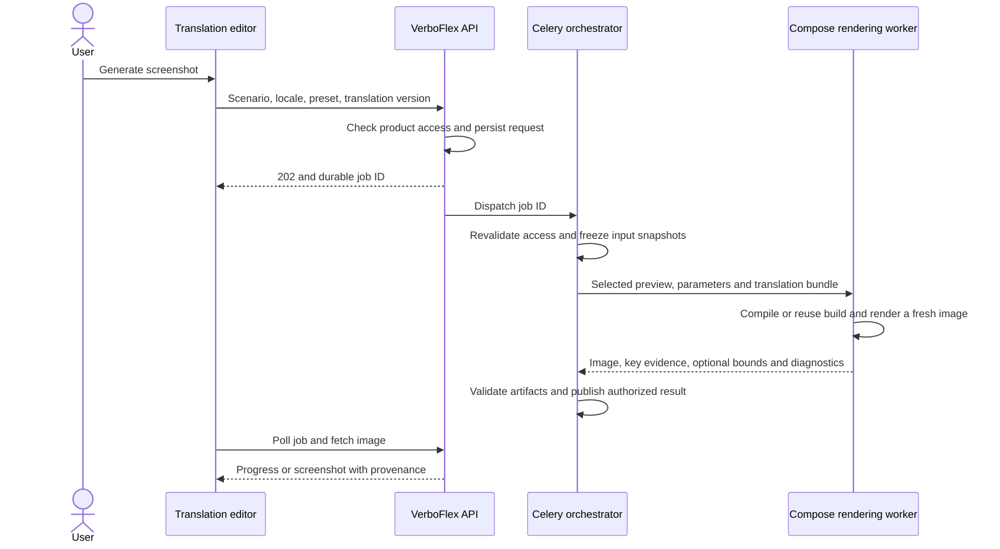

# Kotlin and Java keys with Android screenshots on demand

Status: proposed implementation plan. Updated 12 October 2026.

VerboFlex will import localization keys defined in Kotlin or Java from an application
repository, associate them with language values in a separate translation repository,
and generate a screenshot when a user requests visual context for a key. The complete
delivery includes both code import and working Android capture.

The first capture engine renders registered Jetpack Compose screen previews on the
worker host using Layoutlib through Compose screenshot tooling. Each request starts
a fresh render of the selected preview. Build artifacts and dependencies may be reused;
opening a translation never generates screenshots in the background. A preview adapter
supplies synthetic state and translations from the second repository. Android Studio
does not need to be open, and this engine does not require an emulator.

## Scope and assumptions

The first release supports explicitly configured Kotlin and Java key declarations,
exact joins to supported translation files, source usages, Compose screen previews,
and screenshots using imported values or an explicitly
selected saved translation proposal. Unsaved editor text must be saved before capture.
Generating a screenshot does not approve, commit or submit a translation.

The actual declaration syntax and translation format still need a synthetic example.
Until supplied, use fixtures covering Kotlin constants, Java constants, enums with an
explicit key value, and configured localization calls. Do not interpret every string
literal as a localization key. The application UI technology, build variant and
translation-loading mechanism are also onboarding inputs.

Automatic reconstruction of arbitrary screens from key names is outside the contract.
Each capturable screen needs a renderable preview function and deterministic state.
A key may occur on several previews or nowhere in the registered scenarios; both are
valid outcomes. Kotlin/Java key extraction is independent of the UI technology; screens
that cannot render through Compose previews need a later optional instrumentation engine.

## Existing foundations and required changes

| Area | Existing behavior | Required change |
| --- | --- | --- |
| Repository mapping | `direct` and `separate`, explicit keys/translations sides, branches and roots | Add a versioned code-source configuration to the keys side of a separate mapping |
| Discovery | Localization suffixes only | Add bounded Kotlin/Java source discovery, distinct from Android build checkout |
| Canonical import | Both sides must use matching localization formats; keys require source text | Introduce a code key catalog and a separate catalog-to-values join |
| Stable key identity | Keys belong to a localization scope, repository and branch | Preserve stable IDs across source-file moves; retain declaration and usage provenance separately |
| Authoring and writeback | Existing format-aware editing, review and provider checks | Write only translation files for code-source mappings; support missing values for an existing code key |
| Background work | Durable jobs dispatched by Celery, with stale-work handling | Add extraction and screenshot orchestration with durable progress and recovery |
| Translation context | Comments, history and source changes | Add source usages, available scenarios and screenshot controls |
| Authorization | Product membership is checked in API and background operations | Apply the same current membership authority to jobs, logs and image retrieval |

Implementation anchors:

- [Repository sides](../backend/src/verboflex/models/product_mapping.py)
  and [mapping service](../backend/src/verboflex/services/mappings.py).
- [Discovery](../backend/src/verboflex/services/repository_discovery.py),
  [canonical registry](../backend/src/verboflex/localization/importing/registry.py)
  and [import activation](../backend/src/verboflex/services/translation_imports.py).
- [Translation models](../backend/src/verboflex/models/translation.py),
  [authoring](../backend/src/verboflex/services/translation_authoring.py)
  and [writeback authority](../backend/src/verboflex/services/writeback_authority.py).
- [Celery configuration](../backend/src/verboflex/worker/celery_app.py),
  [preview tasks](../backend/src/verboflex/worker/preview_tasks.py)
  and [product access rules](product-membership.md).
- [Translation context panel](../frontend/src/features/translations/TranslationContextPanel.tsx).

## Code extraction and translation association

Add `keys_source_kind = localization_files | kotlin_java` to the mapping configuration,
defaulting existing records to `localization_files`. Code mode requires separate keys
and translations sides. Version extraction rules, included roots, excluded roots,
declaration selectors and recognized localization-call signatures with the mapping.

Use syntax parsers for Kotlin and Java in a bounded extractor process. Phase 0 selects
and pins the parser implementations against the agreed syntax fixtures. Extraction
must not run Gradle, compile the application or execute repository code. Support
literal initializers and a documented subset of constant references and concatenation;
detect cycles, ambiguous symbols and unresolved expressions explicitly. Exclude tests
and generated/build directories by default, allowing explicit checked-in source roots.

Each definition records its resolved logical key, symbol, file, line/span, language,
application commit and extraction-rule version. Store usage locations independently:
several symbols or calls can refer to one key. Multiple declarations for the same key
produce a diagnostic and require an explicit alias rule to be accepted. Never merge
unrelated constants just because their string values happen to match.

Join the catalog to translation values by the exact logical key within its configured
scope. No fuzzy matching, case folding or guessed prefix removal. Any name conversion
must be an explicit, versioned rule with collision detection. Preserve native plural
and array selectors from translation files; code constants do not imply those shapes.

Allow a key without a source sentence. The configured base-language value may come
from the translation repository; otherwise display “Source text unavailable” and keep
the key usable. Do not turn its identifier into fabricated source text. Track keys
without translations and translations without a code definition as distinct states.

The current canonical registry cannot express this by merely adding `.kt` and `.java`
to its suffix list. Introduce `CodeKeyCatalog` and a mapping-import envelope containing
the catalog plus parsed language values. Adapt staging, atomic activation, search,
coverage, constraints and source-change reconciliation so keys can exist without a
`TranslationValue`. Keep language-value locators tied to real translation files.

A parser error, truncated scan or unresolved declaration in the configured declaration
set prevents authoritative replacement of the catalog. Partial discovery must never
remove existing keys. A complete successful refresh applies the existing removal and
purge rules, including dependent usages, scenario bindings and derived screenshot
access. Renames remain explicit remove/add events unless a reviewed migration maps
them. File moves alone preserve identity and translation history.

For code mode, disable creating or renaming a key through translation authoring: its
definition belongs in the application repository. Filling missing language values for
an existing key remains supported where a real writable destination exists. Reuse
current serializers and PR safeguards for the translation repository. Existing
provider limits remain in force, including public GitHub import and Bitbucket remote
submission; this plan does not silently add private GitHub or GitHub writeback.

## Android integration and screen association

Add a versioned, declarative screen manifest to the application repository, backed by
preview/test code. The manifest names a registered runner profile, module, variant,
fully qualified preview functions, scenario IDs, fixture IDs, supported
devices/locales/themes and declared key bindings. Existing `@Preview` functions can
be reused if they accept the required state and translation context; add thin wrappers
in the screenshot source set where needed. `@PreviewParameter` and multi-preview
annotations require explicit parameter-case identities in the manifest. It cannot
supply arbitrary shell commands through the VerboFlex API.

Synthetic example:

```yaml
version: 1
runner_profile: compose-preview
module: app
variant: verboflexDebug
translation_adapter: demo-localization
scenarios:
  - id: login.default
    preview: com.example.preview.LoginDefaultPreview
    fixture: signed-out
    keys: [login.title, login.submit]
  - id: login.invalid-credentials
    preview: com.example.preview.LoginErrorPreview
    fixture: invalid-login
    keys: [login.title, login.error]
```

The Android integration must provide these behaviors:

1. Supply the exact translation bundle through a preview implementation of the app's
   localization interface, such as a `CompositionLocal` provider. Initially generate
   immutable Kotlin fixture data or Android resources before rendering; include the
   bundle hash in build inputs. Preview code must not fetch translation files or make
   network requests. Merely setting `@Preview(locale = ...)` does not connect a custom
   localization service to the second repository. Hardcoded preview labels must be
   replaced by real key lookups through the injected provider.
2. Render the actual screen composable with synthetic state, theme, locale, dimensions,
   density and font scale. Feed explicit UI state into the screen instead of constructing
   a production ViewModel, navigation controller or dependency-injection graph. Keep
   adapters/wrappers in preview/test source sets, excluded from release behavior.
3. Render only the registered preview and parameter case, with deterministic clock,
   animation state and a timeout. Phase 0 must prove selective execution with the
   chosen engine; if filtering is unavailable, use a dedicated generated wrapper/suite
   instead of running every project preview for each request.
4. Report key lookups and, where supported by the selected engine plus app adapter,
   visible bounds. A lookup alone proves use, not visibility: a Compose modifier must
   associate the key with a rendered node. Verify access to layout data in Phase 0;
   highlighting is a separate capability and must not be claimed from pixels alone.

The initial scenario list uses declared bindings and source references. Runtime capture
adds observed evidence for that precise scenario and state. Label declared, statically
referenced and visibly observed associations separately. If a key is offscreen or not
present in that state, return that result without highlighting unrelated text. The same
word appearing twice is insufficient evidence to identify a key.

Use Compose Preview Screenshot Testing through Gradle as the first rendering adapter.
The official tooling supports generating images from composable previews without an
open IDE. It remains experimental. Current documentation recommends AGP test suites
for compatible versions and deprecates the standalone plugin path. Pin a tested
AGP/Kotlin/JDK/Compose/Layoutlib combination after checking the pilot application;
do not require an application upgrade to an alpha AGP merely to follow the newest DSL.
[Compose screenshot testing](https://developer.android.com/studio/preview/compose-screenshot-testing)
and [AGP screenshot test suites](https://developer.android.com/studio/preview/compose-screenshot-testing-with-testsuites).

Use image-generation tasks, collecting their output in a disposable checkout. Serving
a preview does not require an approved reference image or a pixel-diff test. Generated
reference files are job artifacts and must never be committed to either repository.
Force fresh execution of the selected render step when Gradle would otherwise return
an up-to-date/cached image, while retaining compilation/dependency caching. Record job
provenance from that execution so a leftover image cannot pass as a new result.

Compose previews use Layoutlib and have file/network and dependency-injection
limitations; the resulting image represents the configured preview state.
[Compose preview limitations](https://developer.android.com/develop/ui/compose/tooling/previews#limitations_and_best_practices).
Retain a later instrumentation adapter for unsupported screens or device-specific
behavior. It is explicitly selected and provisioned, never a silent fallback or a
dependency for the Compose-preview release.

## Capture request and execution

The user selects a key, scenario, language and device preset in **String context →
Screenshots**, then presses **Generate screenshot**. If there are several scenarios,
show a choice; if none exist, explain that the application needs a screen binding.
Opening the panel may show a previous result with its timestamp, but performs no capture.

Proposed flow:



Freeze the mapping revision, code commit, translation import/commit, extraction version,
scenario manifest, runner/toolchain/Layoutlib version, device preset, locale, font scale, theme,
fixture and any selected saved-proposal version. The default uses the currently
imported snapshots. If the user wants later branch contents, refresh first; do not
quietly capture a different revision from the text shown in the editor.

Create an immutable effective translation bundle: imported values plus only the
explicitly selected saved proposal. Record its digest and verify that the Android
adapter loaded it before claiming success. Other pending edits must not leak into the
image. A proposal or mapping change during preparation returns a conflict requiring a
new request, or the completed result clearly retains its original frozen version.

Every new **Generate** action makes a new capture. An idempotency token prevents a
retried HTTP request from starting it twice. Reuse only in-flight work with identical
inputs and compatible access; initially scope deduplication to the same requester.
Completed images are history, not silent substitutes for a new capture.

Persist states `queued`, `preparing`, `building`, `rendering`, `collecting`,
`succeeded`, `failed`, `cancelled` and `expired`. Store progress in PostgreSQL, not just
Celery results or browser memory. Add worker leases, heartbeats, bounded retries,
cancellation and stale-job reconciliation. Late results from an expired attempt cannot
publish. Closing the page does not cancel a job; reopening finds its latest state.

Warm dependency/build caches reduce latency. Reset rendering state between jobs. Cache
identities include all build inputs, translation fixture hashes, toolchain and trust
scope. Fresh rendering is mandatory even when compilation is reused. Measure queue,
fixture generation, compilation and render time separately. Phase 0 establishes actual
cold/warm latency on the pilot application before making a response-time commitment.

## Runner deployment and authority

Keep repository fetches and job orchestration in Celery. Assemble the complete build
source as a separate bounded operation from localization discovery: code import does
not need the full Android build tree. Resolve both repositories to immutable commits;
handle LFS, submodules and private dependencies only when the runner profile explicitly
supports them. Stage source bundles before untrusted build execution.

Run Gradle and the rendering engine in a dedicated Android execution environment, separate
from ordinary API/import workers. Application build scripts are executable repository
code. Use disposable workspaces and separate identities, without production database,
Redis, provider-token, signing-key or Docker-socket access. A trusted controller exchanges
bounded jobs and artifacts with the orchestrator; the build subprocess receives no
controller credentials. Restrict dependency download access and keep synthetic app
services isolated from production. Limit CPU, RAM, disk, log size, artifact size and time.

Provision a runner image with the validated JDK, Android SDK, Gradle dependencies,
Layoutlib native libraries and deterministic fonts. Verify host OS/CPU compatibility
and rendering in the intended container environment. The Compose engine requires no
emulator or hardware virtualization; memory and compilation costs still need limits.
An optional future emulator profile has separate host and acceleration requirements.

Product members with translation read access may request captures within configured
quotas. Only administrators configure repository and runner mappings, matching current
product configuration authority. Revalidate membership generation, product state and
configuration authority before dispatch, when claiming work and before publishing.
Membership removal/regrant must not revive old work. Enforce current read access for
status, source snippets, logs and every image download; serve artifacts through an
authenticated API rather than public permanent URLs. Scope proposal inputs to the
same product and translation authority as the request.

Store validated PNG/WebP artifacts with dimensions, digest and provenance in private
storage. Initial proposed retention is seven days, configurable by deployment. Cleanup
runs through Celery and removes artifacts when their owner/product is purged. Preserve
content-free audit events. Avoid storing the full UI hierarchy; retain only bounded
key IDs and rectangles needed for visual context.

## Data and API changes

Add Alembic migrations for versioned extraction configuration, catalog snapshots,
definition/usage provenance, scenario manifests/bindings, screenshot jobs/attempts and
artifacts. Keep code definitions separate from writable translation-value locators.
Snapshots become visible atomically after successful extraction/import. Job rows own
their immutable input identities and authorization generation.

Proposed product-scoped API capabilities:

| Operation | Contract |
| --- | --- |
| List key usages | Paginated source locations pinned to a catalog commit |
| List screen scenarios | Available scenarios and evidence for the selected key |
| Request screenshot | `POST`, idempotency token, `202` with durable job ID |
| Read job or latest job | Durable state, bounded diagnostics and frozen input metadata |
| Cancel job | Idempotent cancellation with worker acknowledgement |
| Read artifact | Authenticated access, private caching policy and provenance |
| Configure extraction/capture | Versioned administration with capability validation |

Use the existing `/translations` and administration route conventions when specifying
exact paths. Reject arbitrary repository URLs, commands and artifact paths in capture
requests. Report unsupported patterns, build failure, missing dependencies, missing
scenario, readiness timeout, missing visible key, revocation and expired artifacts as
distinct actionable outcomes. Regenerate OpenAPI/frontend and MCP contracts where
their exposed schemas change; screenshot-specific MCP tools are a separate decision.

## Implementation sequence and completion checks

| Phase | Work and ownership boundary | Exit criterion |
| --- | --- | --- |
| 0 — Contract and executable spike | Synthetic Kotlin/Java declarations, matching translation files, one complete Compose screen preview, parser comparison and runner profile | Resolve the exact syntax; render only the selected preview with text supplied from the second repo; prove fresh rendering, evaluate bounds support and record cold/warm times |
| 1 — Code catalog | New `localization/code_keys/` boundary, discovery configuration, migrations and extraction jobs | Kotlin and Java fixtures produce exact definitions/usages; unresolved or partial scans cannot replace active data |
| 2 — Import and authoring | Catalog/value join, staging/activation, search, coverage, constraints and translation-only writeback | A code-only key with no base sentence is searchable; missing language value can be authored, reviewed and serialized; moving code preserves history |
| 3 — Compose preview integration | Preview wrappers/provider, scenario manifest, generated translation fixtures and key reporting | Full-screen previews render the requested language/proposal and parameter case with deterministic state; release behavior excludes preview adapters |
| 4 — Screenshot service | Durable job/attempt models, API, Celery orchestration, runner controller, private artifacts and recovery | An API request generates a fresh image from exact inputs; cancellation, worker loss, quotas and access revocation are handled |
| 5 — Editor and onboarding | Mapping UI, source usages, Screenshots panel, presets, progress, result metadata, image zoom and optional bounds overlay | A translator can request, leave, return and inspect the image; multiple/missing scenarios and failures are understandable |
| 6 — Integrated release | Synthetic stack/Compose runner CI, deployment docs, migration rehearsal, purge/retention checks and pilot onboarding | The complete two-repository workflow passes with actual Compose renders on demand; feature gates can be enabled for the pilot |

Phase 0 precedes implementation commitments. Phase 1 precedes Phase 2. Phase 3 can be
developed alongside the catalog once contracts are fixed; Phase 4 consumes the Android
adapter contract, Phase 5 consumes the API, and Phase 6 requires all paths. The first
product release is complete only after the screenshot workflow passes, even if catalog
work is merged earlier. An emulator/instrumentation engine is an optional extension
for screens or behaviors outside the Compose preview contract.

## Verification and rollout

Use synthetic data throughout, following [CONTRIBUTING](../CONTRIBUTING.md) and
[application checks](application-ci.md). Required tests include:

- Kotlin/Java constants, enums, configured calls, escaped literals, aliases, imports,
  static references, duplicate/colliding keys, dynamic expressions, parse errors,
  generated-source exclusions, file moves and bounded discovery failures.
- Keys with no values, absent base text, orphan translations, plurals/arrays, exact
  joins, atomic refresh, base-text changes, review conflicts and existing localization
  mappings. Round-trip fixtures must prove unrelated translation bytes are preserved.
- Membership and cross-product denial for enqueue/status/images/logs; revocation while
  queued/running; removal/regrant; malicious paths/artifacts; late worker completion;
  retries, cancellation, quota limits and expired artifacts.
- Actual Compose renders for full-screen previews, two languages, RTL, a long translation,
  increased font scale, multi-preview and parameter cases. Assert bundle digest,
  selected preview/key, changed rendered output after an edit and fresh rendering on
  repeated requests. Assert bounds where that capability is supported; otherwise show
  the image without a misleading highlight. Unsupported previews return diagnostics.
- One full user flow: import code keys plus separate translations, edit/save a proposal,
  request capture, leave/reopen the editor and see the newly rendered text. Verify the
  capture leaves both Git repositories unchanged and another product cannot fetch it.

Run fast unit/API/contract tests in the existing application workflow. Add a separate
Compose integration job on an eligible runner with pinned SDK/Layoutlib/fonts, synthetic
app fixtures and retained bounded evidence. Mocks validate orchestration; they do not
replace the real capture gate. Keep the normal import queue responsive under concurrent
captures and measure queue fairness plus cold/warm render times.

Release behind independent code-import and Android-capture capability flags. Rehearse
migrations with existing `direct` and `separate` mappings, provision the runner and
private storage, register the pilot profile, then enable both capabilities for the
pilot product. Update English user/deployment documentation with supported syntax,
screen registration, expected waits, permissions, retention and failure recovery.

The pilot onboarding checklist must settle four concrete inputs: the real key pattern,
translation format/base locale, the Android build/toolchain and renderable preview
functions. These specialize the adapters without changing the two-repository and
on-demand screenshot requirements.
